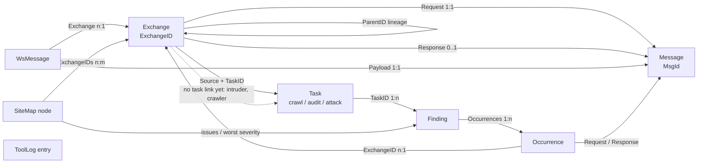

# burpsy data model

Written after a finding was found reported against the wrong URL. That bug was not a typo — it was
the data model letting a caller ask a question the types could not check. This document says what
the entities are, how they are identified, how they relate, and which relations do not exist yet.

## 1. The identity hazard, first

burpsy has **two dense id spaces that both count from zero**:

| Space | Type | Assigned by | Counts |
|---|---|---|---|
| Message | `core.MsgId` | `TrafficStore.Put` | every request or response body stored |
| Exchange | `core.ExchangeID` | `TrafficStore.AddExchange` | every request/response pair |

For six proxied requests the store holds messages `0..11` and exchanges `0..5`. Every exchange id is
*also* a valid message id, and roughly half the message ids are *also* valid exchange ids. So:

```go
ex, err := s.store.GetExchange(uint64(occ.Request)) // occ.Request is a MsgId
```

does not fail. It returns a real exchange belonging to an unrelated request. That is how findings on
`/search` were reported against `/login`, and how findings whose message id ran past the exchange
count lost their host and path entirely — in the issues API and in every exported report.

**Rule:** an id that names a row must be a distinct type, and every lookup must take that type. Both
now are, so that line no longer compiles — which is the point. A caller starting from a message uses
`TrafficStore.ExchangeByRequest(MsgId)`, the only correct way from a message to its exchange;
`GetExchange` takes an `ExchangeID` and nothing else.

**Corollary:** zero is never a usable "unset" marker in either space. `Occurrence.ExchangeID == 0`
means exchange 0 just as legitimately as it means "not recorded". Absence needs a pointer, a
sentinel, or a cross-check against another field — never a zero test.

## 2. Entities

### Owned, append-only, authoritative

- **Message** — `MsgId`, direction, raw bytes (resident or on-disk span). Position *is* the id.
- **Exchange** — `ID ExchangeID`, `Request MsgId`, `Response *MsgId`, host, port, TLS, method, path,
  status, protocol, `Source`, `TaskID`, `ParentID *ExchangeID`, duration, `Related []ChildRef`.
  Position *is* the id.
- **WsMessage** — `ID MsgId`, `Exchange ExchangeID`, `Payload MsgId`, direction, opcode. **Already
  modelled its relation correctly** before any of this work — it names the handshake exchange that
  opened the socket. It is the shape the rest of the model was made to match.
- **Finding** — `ID`, name, severity, confidence, description, remediation,
  `Occurrences []Occurrence`, `Inserted`, `TaskID`.
- **Occurrence** — `ExchangeID`, `Request MsgId`, `Response *MsgId`, `Span`. Where one finding was
  seen. A finding with three occurrences is one advisory at three locations.

### Derived views, rebuildable from the above

- **SiteMap** — `HostNode(host:port:tls)` → `PathNode(path)` → `ExchangeIDs`. Follows the store as an
  observer; never the source of truth.
- **ToolLog** — what each tool sent, kept separate from proxy history.
- **Coverage / Task summaries** — what ran, what was skipped, what is still gated.

### Configuration, operator-owned

Scope rules, Match & Replace rules, session/macro rules, scan configurations, intercept rules.

## 3. The relationship graph



Solid edges are modelled and tested. The one dotted edge is a producer gap, not a model gap — see
below.

## 4. Gaps

All six are now closed.

| # | Relation | What landed |
|---|---|---|
| G1 | Typed exchange id | `type ExchangeID uint64`, threaded through the store, scanner, proxy, web and CLI. `TrafficStore.ExchangeByRequest(MsgId)` is the only way from a message to its exchange; `GetExchange` no longer accepts a bare number. |
| G2 | Stable node identity | `sitemapNodeView.Key` — host, or host + NUL + path. The colliding 31-based hash is gone, and the UI takes the server's key instead of rebuilding the same string itself. |
| G3 | Finding → node | Every node reports `issues`, `subtree_issues` and `worst_severity`, rolled up so a collapsed branch still says what is inside it. The tree renders a severity square per node. |
| G4 | Exchange → Task | `Exchange.TaskID`, carried by `scanner.Capture` beside `Source` with the same per-exchange override, so a capture site added later inherits it. |
| G5 | Finding → Task | `Finding.TaskID`, set by both active-audit paths and by the passive capture path. |
| G6 | Exchange lineage | `Exchange.ParentID *ExchangeID`, recorded on a Repeater resend from the exchange the operator sent to Repeater, and validated against the store so a dangling link is dropped rather than stored. |

### Still open, and deliberately

- **Intruder does not create exchanges.** Its `record` callback stores raw response *messages* only,
  so an attack contributes nothing to history or the site map, and the dashboard's per-source panel
  reports `intruder 0 exchanges`. `TaskID` is plumbed and will populate the moment Intruder captures
  through `scanner.Capture` like every other producer.
- **The crawler is not wired to the web server** (roadmap Phase 6), so no crawl task exists to stamp.
  The crawler's own `Capture` handle already carries the field.

Both are producer gaps, not model gaps: the relation exists and is tested, and nothing has to change
here when those producers arrive.

## 5. Invariants worth stating

1. **Memory is authoritative, SQLite is a durable mirror.** A mirror write failing is the mirror's
   problem, never the traffic's.
2. **Derived views are observers, never read-path rebuilders.** A view rebuilt on read hides a broken
   subscription, which this project has shipped twice.
3. **Absent is absent, not zero.** A pending request is not a 0-status response; a missing
   Content-Type is not the empty MIME type; exchange 0 is not "no exchange".
4. **Attribution is never guessed.** If a finding's exchange cannot be resolved, its path is reported
   empty. A plausible-looking wrong URL is worse than a blank one, because it gets remediated.
5. **Ids are dense and reused across kinds.** Never infer a row's kind from the magnitude of its id.
